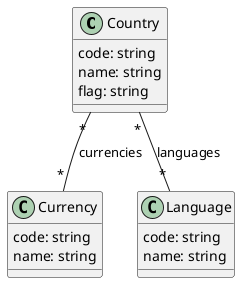

# Country Module Entities

## UML Class Diagram

## Entity Descriptions

- **Country**: Represents a country with a code, name, flag, and many-to-many relations to currencies and languages.
- **Currency**: Represents a currency with a code and name.
- **Language**: Represents a language with a code and name. 